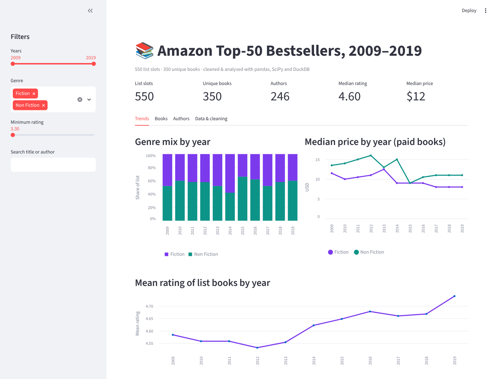
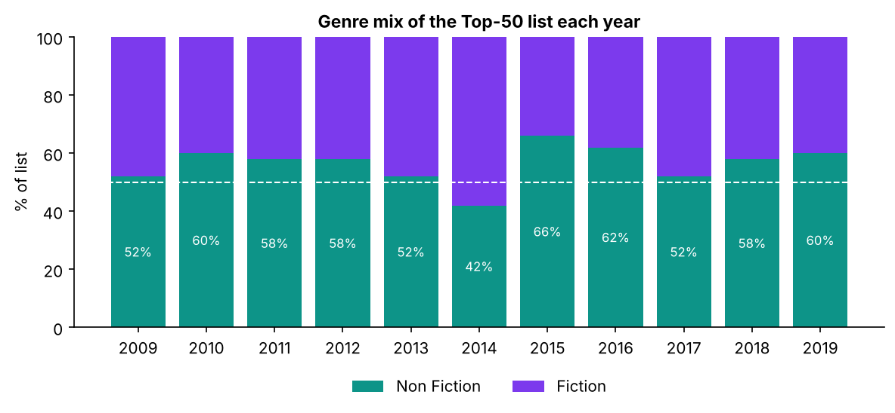
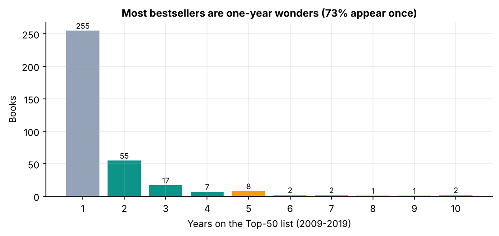
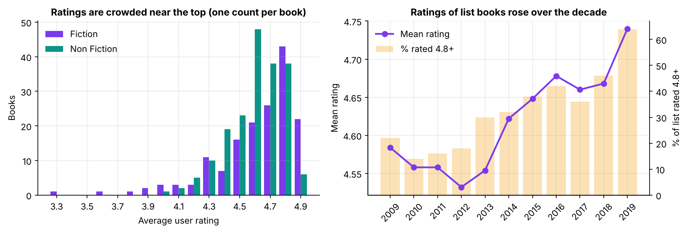
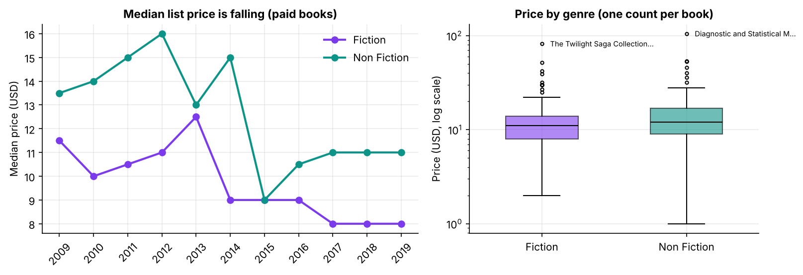
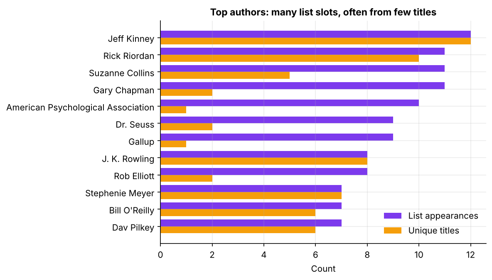
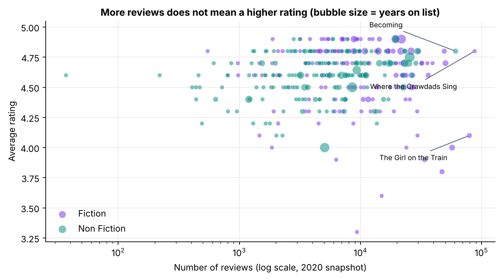

<div align="center">

# 📚 What Makes an Amazon Bestseller?

### Cleaning, analysing and testing 11 years of Amazon's Top-50 bestselling books (2009–2019)


<!-- After pushing, replace YOUR-USERNAME to activate the CI badge:
 -->



</div>

---

## 📌 Overview

Amazon publishes a list of its 50 bestselling books every year. Using the 2009–2019 lists (550 entries, 350 unique
books, 246 authors) this project answers six questions:

1. Is the list dominated by fiction or non-fiction, and is that changing?
2. How are bestsellers rated, and do ratings differ by genre or over time?
3. What do bestsellers cost?
4. Which books drive reader engagement?
5. Which authors dominate, and how?
6. How long do books stay on the list?

Along the way it fixes **three data-quality problems** that silently distort the usual analyses of this dataset (see
[Data quality](#-data-quality-the-part-most-analyses-skip)).

> **v2 of my earlier "Panda Project"**, rebuilt from a single script into a tested, reproducible analysis
> package. See [what changed and why](docs/CHANGES_FROM_V1.md).

## 🔑 Key findings

| # | Finding | Evidence |
|---|---|---|
| 1 | **Non-fiction holds 56% of list slots**, with no trend over the decade | Fiction share slope −0.3 pp/yr, p = 0.62; 2014 was the only fiction-majority year |
| 2 | **Ratings barely separate bestsellers**: 80% of books are rated ≥ 4.5 | Fiction median 4.7 vs 4.6 (Mann-Whitney p = 0.017, small effect) |
| 3 | **Ratings of list books rose** from 4.58 (2009) to 4.74 (2019); the share rated 4.8+ went from 22% to 64% | Spearman ρ = 0.29, p < 0.001 |
| 4 | **Books got cheaper**: median paid price fell $12 → $10; fiction $11.50 → $8 | Spearman ρ = −0.22, p < 0.001 |
| 5 | **Fiction drives engagement**: 75% more reviews at the median (8.8k vs 5.0k) | p < 0.001, rank-biserial 0.36 |
| 6 | **73% of bestsellers are one-year wonders**; staying power comes from franchises or evergreen self-help/reference titles | Jeff Kinney placed a new *Wimpy Kid* book every year; Gary Chapman got 11 slots from 2 titles |

Full write-up with every statistic: [`reports/findings.md`](reports/findings.md) (auto-generated) and the
[analysis notebook](notebooks/bestsellers_analysis.ipynb).

<p align="center">
  
  
</p>
<p align="center"></p>
<p align="center"></p>
<p align="center">
  
  
</p>

## 🧹 Data quality: the part most analyses skip

| Issue | Why it matters | Fix |
|---|---|---|
| **One row per book *per year*** | Averaging raw rows counts a 10-year evergreen 10 times. In v1 this exaggerated fiction's rating lead by 4× (gap 0.053 → 0.013) | Two tidy tables: `appearances` (550 slots) for trends, `books` (350 titles) for per-book stats |
| **Author spelling variants** | "J.K. Rowling" and "J. K. Rowling" were counted as two authors | Explicit mapping, unit-tested |
| **"Duplicates" that aren't** | `drop_duplicates()` removes 0 rows (each row is a distinct list slot), but one title appears in two capitalisations | Normalised title keys |
| **$0 prices** | 12 free listings drag down averages | Flagged; excluded from price stats only |
| **Reviews/ratings are a 2020 snapshot** | They repeat across years, so "reviews over time" charts are meaningless | Documented; trends interpreted as *which books made the list* |
| **Mislabelled metric** | v1 called `value_counts()` "books published per author"; it's list appearances | Report both appearances and unique titles |

Every cleaning step is recorded in a machine-generated log (shown in the dashboard and in `findings.md`).

## 🧠 Methods

- **pandas** for cleaning and reshaping; a `books` vs `appearances` grain chosen per question.
- **Non-parametric statistics** (SciPy): Mann-Whitney U with rank-biserial effect sizes (ratings are bounded and
  skewed, so no t-tests), Spearman correlation for trends, OLS for genre share.
- **SQL**: the key analyses are re-implemented in [`sql/queries.sql`](sql/queries.sql) (CTEs, window functions) and run
  on **DuckDB**. Tests assert that SQL and pandas give identical answers.
- **Reproducibility**: one command regenerates every figure, table and the findings report; CI rebuilds them on every push.

## 🗂️ Project structure

```
amazon-bestsellers-analysis/
├── data/raw/bestsellers.csv        # source data (550 rows)
├── src/bestsellers/
│   ├── data.py                     # load → validate → clean (with log) → books table
│   ├── analysis.py                 # one small, tested function per question
│   ├── viz.py                      # consistent, publication-quality charts
│   ├── sql.py                      # runs sql/queries.sql on DuckDB
│   └── report.py                   # regenerates figures, tables and findings.md
├── sql/queries.sql                 # the same analyses in SQL
├── notebooks/bestsellers_analysis.ipynb   # narrative analysis
├── app/streamlit_app.py            # interactive dashboard with filters & CSV export
├── reports/
│   ├── findings.md                 # auto-generated write-up
│   ├── figures/                    # 7 charts + dashboard screenshot
│   └── tables/                     # CSV outputs (incl. corrected v1 exports)
├── tests/                          # 22 tests: cleaning, stats, SQL-pandas parity
├── docs/CHANGES_FROM_V1.md
├── Makefile · pyproject.toml · requirements*.txt
└── .github/workflows/ci.yml
```

## 🚀 Quickstart

```bash
git clone https://github.com/YOUR-USERNAME/amazon-bestsellers-analysis.git
cd amazon-bestsellers-analysis
python -m venv .venv && source .venv/bin/activate      # Windows: .venv\Scripts\activate
make setup            # or: pip install -r requirements-dev.txt && pip install -e .

make report           # regenerate figures, tables and reports/findings.md
make sql              # run the SQL versions of the analyses
make test             # 22 tests
make app              # dashboard at http://localhost:8501
```

No `make` on Windows? Run the commands from the [Makefile](Makefile) directly, e.g. `python -m bestsellers.report`.

## ⚠️ Limitations

- No within-year rank, so the #1 and #50 books are weighted equally.
- Ratings and review counts are a single 2020 snapshot.
- Genre is a coarse two-way label; no sub-genre, format or page count.
- Observational data: associations, not causes.

**Next steps:** enrich with Open Library / Goodreads metadata (sub-genre, format, publication date) and model which
features predict a book staying on the list for more than one year.

## 📚 Data source

*Amazon Top 50 Bestselling Books 2009–2019*, scraped from Amazon and published on Kaggle by Souter Saalu (2020).
See [`data/README.md`](data/README.md) for the data dictionary.

## 👩‍💻 Author

**Ayushika Mishra** · [LinkedIn](https://www.linkedin.com/in/YOUR-PROFILE) · [GitHub](https://github.com/YOUR-USERNAME)
